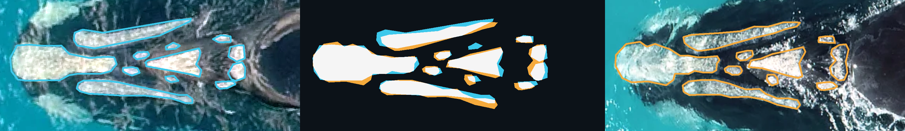

# Semi-automated identification of southern right whales from drone imagery by classical image matching methods



[](https://doi.org/10.64898/2026.07.19.739396)
[](https://www.biorxiv.org/content/10.64898/2026.07.19.739396v1)

Ben Fabry<sup>1</sup> [](https://orcid.org/0000-0003-1737-0465),
Greta Jacobs<sup>1</sup>,
Johannes Bartl<sup>1</sup> [](https://orcid.org/0000-0003-1547-6450),
Max Fabry<sup>2,3</sup>

<sup>1</sup> Department of Physics, Friedrich-Alexander University of Erlangen-Nuremberg, Erlangen, Germany<br>
<sup>2</sup> Centre for Sustainable Aquatic Ecosystems, Murdoch University, Perth, Western Australia, Australia<br>
<sup>3</sup> School of Biological Sciences, University of Western Australia, Perth, Western Australia, Australia

This is the official repository for the
[paper on bioRxiv](https://doi.org/10.64898/2026.07.19.739396). It contains a small, standalone
example of the matching procedure: southern right whale photographs are
matched by the pattern of their callosities, using two methods, HOG and
log-chamfer.

## Run

Requires Python 3.10–3.13. Open a terminal in this folder:

    python -m pip install -r requirements.txt
    python match.py

Choose a query from the numbered list; both methods run by default.
To choose a query and method directly:

    python match.py --query Query_SW0089.png --method hog
    python match.py --query Query_SW0089.png --method chamfer
    python match.py --query Query_SW0089.png --method both

On Windows, `py` can be used instead of `python`. No server, database,
network connection or trained model is needed after installing the packages.

## Structure

    match.py                 Choose a query, run the methods, print the ranking.
    srw_matching/
        hog.py               HOG distance between edge-orientation descriptors.
        chamfer.py           Capped log-chamfer distance between sampled edges.
        registration.py      Mask preparation and alignment search.
    data/
        gallery/photos/      Gallery_SWxxxx.png       (10 photographs)
        gallery/masks/       Callosities_Gallery_SWxxxx.png
        query/photos/        Query_SWxxxx.png         (10 photographs)
        query/masks/         Callosities_Query_SWxxxx.png
        image_pairs.csv      Dates and file correspondence for each pair.
    tests/
        expected_rankings.csv   Reference output for all queries and methods.
        test_rankings.py        Checks the program against that output.

All images are standardized to 1200 × 1000 pixels. In the masks, white is
callosity and black is everything else. **Matching uses only the masks**; the
photographs are for inspection. Each gallery/query pair was photographed on
different dates. The whale codes only label the examples and are not used in
matching.

## What the program does

1. Extract callosity edges from the head region of each mask.
2. Obtain a coarse alignment by normalized image correlation.
3. Refine the alignment (shift, rotation, scale) to minimize the HOG or chamfer distance.
4. Rank all gallery images by distance. Lower is better.

The ranking suggests candidates; confirm an identity by looking at the photographs.

## The gap

The program reports **g = d2 − d1**, the distance between the best and
second-best gallery image. A larger gap means the top candidate stands out
more clearly in this gallery. It is not a probability or a validated
accept/reject threshold. HOG and chamfer distances use different scales and
should not be compared with each other.

## Checking the output

    python tests/test_rankings.py

Compares every query and method with `tests/expected_rankings.csv`. Tiny
floating-point differences across OpenCV versions are tolerated.

## Adding images

Add a standardized 1200 × 1000 photograph and its binary mask to the matching
`photos/` and `masks/` folders, using the same naming convention. This example
does not segment or standardize images automatically.

This small set illustrates the procedure; it does not measure accuracy on the
full research catalogue.

## Citation

If you use this code, please cite:

> Fabry B, Jacobs G, Bartl J, Fabry M. Semi-automated identification of
> southern right whales from drone imagery by classical image matching
> methods. *bioRxiv* (2026). https://doi.org/10.64898/2026.07.19.739396

```bibtex
@article{fabry2026srw,
  title   = {Semi-automated identification of southern right whales from drone imagery by classical image matching methods},
  author  = {Fabry, Ben and Jacobs, Greta and Bartl, Johannes and Fabry, Max},
  journal = {bioRxiv},
  year    = {2026},
  doi     = {10.64898/2026.07.19.739396},
  url     = {https://www.biorxiv.org/content/10.64898/2026.07.19.739396v1}
}
```

## Contact

Ben Fabry, Department of Physics, Friedrich-Alexander University of
Erlangen-Nuremberg, Henkestr. 91, 91052 Erlangen, Germany<br>
ben.fabry@fau.de
